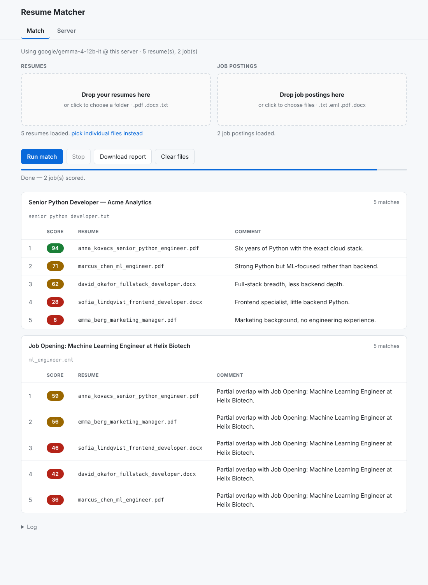

# Resume Matcher — web version

A third take on the tool, on the `web` branch: **plain HTML, CSS and JavaScript**,
no build step, no framework, no backend of its own. Everything runs in the
browser and talks to an OpenAI-compatible model server. Built to be hosted on a
home server and used from any device on the network, including a phone.



## Why this one is different

The desktop versions read a folder and run on one machine. This one runs
wherever you open it, and **nothing is installed on the client at all**.

Resumes are parsed in the browser — the files themselves are never uploaded
anywhere. Only the extracted text goes to the model server, exactly as in the
desktop versions, one job and one resume per request.

## The one thing that decides your setup: origins

A browser blocks a page on one origin from calling an API on another unless
that API sends CORS headers. I verified this in Chromium against a mock server:

```
model server WITHOUT CORS headers: blocked — "Response to preflight request
                                   doesn't pass access control check"
model server WITH    CORS headers: works
```

So you have two options.

### Recommended: one origin, via a reverse proxy

Put the page and the model API behind the same host. The browser then sees one
origin, and CORS never enters the picture:

```
browser ──► http://truenas.lan:8080/        ──► this app (static files)
            http://truenas.lan:8080/v1/*    ──► vLLM, a separate app
```

**vLLM stays its own TrueNAS app.** Nothing needs to share a container. The
proxy just maps paths to backends; they can be different containers, or
different machines.

`Caddyfile` and `docker-compose.yml` here do exactly that:

```bash
VLLM_UPSTREAM=192.168.1.10:8000 docker compose up -d
```

On TrueNAS SCALE: *Apps > Discover Apps > Custom App*, install via YAML. Point
`VLLM_UPSTREAM` at wherever vLLM listens — from inside a container that is the
TrueNAS host's LAN address, **not** `localhost`.

Then open `http://<truenas>:8080` and leave *Base URL* as `/v1`.

### Alternative: let vLLM send CORS headers

Unlike Unsloth Desktop, vLLM's OpenAI server can allow browser origins itself
(`--allowed-origins`; check the flag against your version). Then you can point
*Base URL* straight at `http://truenas.lan:8000/v1` with no proxy. It works,
but you lose the single URL and any API key has to live in the browser.

## Using it

1. **Server tab** — set the Base URL (`/v1` behind the proxy), press *Fetch*.
   vLLM serves one model, so it is filled in for you.
2. **Match tab** — drop your resumes folder on the left, job postings on the
   right. Drag-and-drop takes folders as well as files, or click to browse.
3. **Run match.** Results appear in the page; *Download report* saves a
   standalone HTML file.

Settings are kept in `localStorage`, per browser.

Supported: `.pdf`, `.docx`, `.txt`, `.md` resumes; those plus `.eml` for job
postings, which keeps the email's Subject as the title.

## Security

**Keep this on your LAN.** There is no authentication. Anyone who can reach the
page can read whatever resumes they load, use your GPU, and see your settings.
Resumes are other people's personal data.

If you ever point it at a hosted API, put the key in the reverse proxy and
leave it out of the browser — anything the page holds is readable in DevTools
by anyone who can load it.

## Layout

```
index.html          the page
css/app.css         follows the browser's light/dark preference
js/scoring.js       prompt + reply parsing, ported from main
js/documents.js     PDF, DOCX, EML and text extraction in the browser
js/llm.js           OpenAI-compatible client and its retry policy
js/matcher.js       the job x resume matrix, concurrency, top N
js/report.js        in-page results and the downloadable report
js/config.js        settings in localStorage
js/app.js           wiring
vendor/pdfjs/       pdf.js 4.10.38, vendored (Apache-2.0)
Caddyfile           the one-origin reverse proxy
docker-compose.yml  Caddy serving the site and proxying /v1
```

`pdf.js` is vendored rather than loaded from a CDN so the app works with no
internet access at all, which is the point of running it at home.

## Behaviour carried over from the desktop versions

These were expensive to get right and are deliberately identical:

- A request that **times out is never resent** — the server is probably still
  working on it, and a second copy doubles the load for a reply nobody reads.
  Only a refused request (429/503) is retried, with backoff.
- **One job and one resume per request**, always a fresh context. Resumes are
  never mixed.
- Ties break by resume name, so two runs of the same data agree.

## What was verified

Run end to end in headless Chromium against a mock vLLM serving the site and
`/v1` from one origin, using the real sample files from `app/examples/`:

- 5 resumes (PDF + DOCX) and 2 job postings (`.txt` + `.eml`) parsed in-browser
- ranked correctly — 94 / 71 / 62 / 28 / 8 for the Python job
- server side saw **exactly 10 calls for 2 jobs × 5 resumes** — no duplicates —
  with `peak_concurrency=4` matching the setting
- no console or page errors

Not verified: a real vLLM server, Safari and Firefox (the folder picker uses
`webkitdirectory`; the "pick individual files instead" link is the fallback),
and the Caddy/TrueNAS deployment itself.
